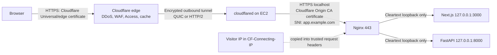

# Cloudflare Implementation and Test Guide for Carta

**Verified against official Cloudflare documentation on 2026-11-20.**

This guide adds Cloudflare Tunnel and Cloudflare edge controls to the existing Carta deployment. It does not install EC2, Docker, Docker Compose, or Nginx. It does not run a deployment, change AWS, or change Cloudflare.

All placeholders are written as `<PLACEHOLDER>`. Never put a real token, API key, database URL, or private key in this file, a shell prompt history, a screenshot, or a Git commit.

## Information Needed From You

Collect these before starting production:

1. `<EC2_PUBLIC_IP>`: the instance's current public or Elastic IP.
2. `<SSH_SOURCE_IP>`: the single public IPv4 or IPv6 address from which SSH administration is allowed.
3. `<DOMAIN>`: the domain added to the Cloudflare account, for example `example.com`.
4. `<APP_HOSTNAME>`: the public Carta hostname, for example `carta.example.com`.
5. `<ACCOUNT_ID>`, `<TUNNEL_ID>`, and the tunnel's dashboard-generated token.
6. The running Nginx deployment type:
   - this repository's existing guide uses an Nginx container named `carta-nginx`, host networking, `/opt/carta-nginx`, and container certificate paths under `/etc/nginx/certs`;
   - the request describes host-installed Nginx. If the live system uses host Nginx instead, replace `docker exec carta-nginx ...` with `sudo nginx ...`, and map the live file path before applying any diff.
7. The actual Clerk issuer, public production origin, allowed parties, callback settings, and publishable key. Read them from the protected EC2 environment files and Clerk dashboard; do not paste them here.
8. Approval for disruptive security-group port removal and a maintenance window for the TLS/origin cutover.

## Repository-Specific Configuration Used Here

| Item | Existing value or route | Source |
| --- | --- | --- |
| Nginx HTTP/HTTPS | `80` / `443` | `docs/NGINX_SETUP_GUIDE.md` |
| Frontend container | `127.0.0.1:3000` | `docker-compose.yml`, Nginx guide |
| Backend container | `127.0.0.1:8000` | `docker-compose.yml`, Nginx guide |
| Frontend/default route | `/` -> `127.0.0.1:3000` | Nginx guide |
| REST/streaming | `/api/*` -> `127.0.0.1:8000` | Nginx guide and FastAPI routes |
| WebSocket | `/ws/transcribe` -> `127.0.0.1:8000` | Nginx guide and `frontend/lib/voice.ts` |
| Health | `/test` -> `127.0.0.1:8000` | FastAPI and Nginx guide |
| Diagnostics | `/docs`, `/redoc`, `/openapi.json` -> backend | Nginx guide |
| Nginx config | `/opt/carta-nginx/conf.d/*.conf` | Nginx guide |
| Existing certificate | `/etc/nginx/certs/carta-self-signed.crt` inside the container | Nginx guide |
| Existing private key | `/etc/nginx/certs/carta-self-signed.key` inside the container | Nginx guide |
| Certificate/key host mounts | `/opt/carta-nginx/certs/` | Nginx guide |
| Frontend API base | `NEXT_PUBLIC_API_URL` | Root `.env`; inlined at frontend image build time |
| Browser CORS origins | `FRONTEND_ORIGIN` | `backend/.env` |
| Clerk JWT `azp` list | `CLERK_AUTHORIZED_PARTIES` | `backend/.env` |
| Clerk server secret | `CLERK_SECRET_KEY` | Root `.env`; runtime secret |

`NEXT_PUBLIC_API_URL`, `FRONTEND_ORIGIN`, and `CLERK_AUTHORIZED_PARTIES` must use the exact public origin. A restart does not rebuild the Next.js public variable.

## Architecture Overview

### Before Cloudflare

```text
Browser
  |-- HTTPS, self-signed origin certificate for <EC2_PUBLIC_IP> --|
                                                                 v
AWS Security Group: public 80/443 -> EC2 Nginx -> 127.0.0.1:3000 (Next.js)
                                                -> 127.0.0.1:8000 (FastAPI/WebSocket)
```

### After Named Tunnel



The tunnel connector makes outbound connections; no public inbound `80` or `443` is required. Cloudflare terminates the browser TLS connection and initiates an authenticated, encrypted connection to the connector. Carta terminates a separate TLS connection at local Nginx with the Cloudflare Origin CA certificate.

**What Cloudflare can and cannot see**

- Cloudflare sees and may process the public hostname, URL, request/response headers, and HTTP body required for proxy features, WAF, Access, caching, and CDN delivery. Do not treat it as end-to-end encryption that bypasses the edge.
- Cloudflare cannot directly see the EC2 private disk, database at rest, Redis data, environment-file contents, or application memory. Application-layer encryption and provider controls still apply.
- `cloudflared` and Cloudflare do not replace Carta's Clerk authentication. Private `/api/*` responses remain authenticated by the application and must not be cached.

## 0. Detect Amazon Linux and Install `cloudflared`

### Configure

Run on the instance and capture its exact operating-system identity:

**Run on EC2 (Amazon Linux)**

```bash
cat /etc/os-release
. /etc/os-release
printf 'Detected: %s (%s)\n' "$NAME" "$VERSION_ID"
case "$VERSION_ID" in
  2023*) PKG=dnf ;;
  2)     PKG=yum ;;
  *)     echo "Unsupported or unexpected Amazon Linux version: $VERSION_ID" >&2; exit 1 ;;
esac
echo "Package manager: $PKG"
```

Expected:

```text
Detected: Amazon Linux (2023...)
Package manager: dnf
```

or:

```text
Detected: Amazon Linux (2)
Package manager: yum
```

### Implement

Cloudflare's official RPM instructions use the stable `cloudflared.repo`. Downloading the current repository definition also avoids the rolled Cloudflare signing key.

**Run on EC2 (Amazon Linux)**

```bash
sudo curl -fsSL https://pkg.cloudflare.com/cloudflared.repo \
  -o /etc/yum.repos.d/cloudflared.repo
sudo "$PKG" -y install cloudflared
```

Official sources:

- [Download `cloudflared`](https://developers.cloudflare.com/tunnel/downloads/)
- [Cloudflare package repository](https://pkg.cloudflare.com/index.html)

### Test

**Run on EC2 (Amazon Linux)**

```bash
cloudflared --version
rpm -q cloudflared
```

Expected: a `cloudflared version ...` line and an installed RPM version. Cloudflare states that supported `cloudflared` versions are within one year of the latest release.

### Rollback

**Run on EC2 (Amazon Linux)**

```bash
sudo "$PKG" -y remove cloudflared
sudo rm -f /etc/yum.repos.d/cloudflared.repo
```

Validate that no existing service depends on the binary before uninstalling it:

**Run on EC2 (Amazon Linux)**

```bash
systemctl list-unit-files | grep -E '^cloudflared' || true
```

## 1. Quick Tunnel (No Account, No Domain)

### Configure

Choose the HTTP origin for the first test. It is the Nginx entry point, not the Compose application ports.

**Run on EC2 (Amazon Linux)**

```bash
printf 'EC2 IP: '; curl -fsS https://checkip.amazonaws.com
curl -sS -o /dev/null -w 'HTTP / -> %{http_code}\n' http://127.0.0.1/
curl -fsS http://127.0.0.1/test
curl -sS -o /dev/null -w 'HTTP /api/me -> %{http_code}\n' http://127.0.0.1/api/me
curl -k -sS -o /dev/null -w 'HTTPS / -> %{http_code}\n' https://127.0.0.1/
curl -k -fsS https://127.0.0.1/test
```

Expected: the frontend returns below `500`; `/test` returns `{"message":"Hello from FastAPI"}`; unauthenticated `/api/me` returns `401` or `403`.

### Implement

Start in a foreground terminal first so the initial URL and errors are visible.

**Run on EC2 (Amazon Linux)**

```bash
cloudflared tunnel --url http://localhost:80
```

Expected in the log:

```text
Your quick Tunnel has been created! Visit it at:
https://<RANDOM-SUBDOMAIN>.trycloudflare.com
```

The URL remains live only while that process runs. Anyone with the URL can use the exposed service. Quick Tunnels are for development and testing, have no uptime guarantee, allow up to 200 concurrent requests, and do not support Server-Sent Events. Each start creates a different hostname.

Do not close the terminal. Copy the full URL as `<QUICK_URL>`.

#### Temporary HTTPS-origin lab

The origin certificate is self-signed and is for the IP, not `localhost`, so this origin handshake is intentionally untrusted and normally would fail.

**Run on EC2 (Amazon Linux)**

```bash
cloudflared tunnel --no-tls-verify --url https://localhost:443
```

`--no-tls-verify` is a **temporary lab workaround only**. Stop using it before production. For production, use a Cloudflare Origin CA certificate and SNI/hostname validation.

### Test

Set one variable locally to the exact HTTPS URL printed by `cloudflared`.

**Run on local Windows PowerShell**

```powershell
$QuickUrl = "https://<RANDOM-SUBDOMAIN>.trycloudflare.com"
curl.exe -fsS "$QuickUrl/test"
curl.exe -I "$QuickUrl/"
curl.exe -I "$QuickUrl/notes/example"
curl.exe -i "$QuickUrl/api/me"
curl.exe -I "$QuickUrl/_next/static/nonexistent.js"
```

Expected:

- `/test`: FastAPI greeting.
- `/`: `200`, `307`, or `308`, consistent with Clerk sign-in state.
- `/notes/example` and other frontend refreshes: a frontend response, not a `404` from Nginx.
- `/api/me`: `401` or `403` without a valid Clerk token.
- `cf-ray` is present on responses; the static miss may be `404` but must still travel through Cloudflare.

Open `$QuickUrl`, sign in, refresh `/`, `/notes`, `/tasks`, and `/folders/<ID>`. Verify notes and tasks load. Check a DevTools Network API request has `server` behavior expected from the Nginx/backend path and no CORS error.

Test WebSocket upgrade on the voice feature in the browser. In DevTools, the Network filter must show `WS`, and `/ws/transcribe` must reach `101 Switching Protocols`. Cloudflare supports WebSockets on all plans; Carta derives `wss://` from the HTTPS `NEXT_PUBLIC_API_URL`.

Press `Ctrl+C` in the foreground terminal.

**Run on EC2 (Amazon Linux)**

```bash
cloudflared tunnel --url http://localhost:80
```

Expected: a **new** URL. Update all local test variables, bookmarks, and temporary auth origins to that new URL.

### Rollback

Press `Ctrl+C`, then verify the hostname is no longer reachable:

**Run on local Windows PowerShell**

```powershell
curl.exe --max-time 15 -I "https://<RANDOM-SUBDOMAIN>.trycloudflare.com"
```

Expected: failure or a Cloudflare error because the Quick Tunnel process is gone. If the EC2 security group was not yet changed, the direct-IP path remains available as the rollback.

Official source: [Quick Tunnels](https://developers.cloudflare.com/tunnel/get-started/quick-tunnels/).

## 2. Security Group Lockdown

> **DISRUPTIVE STEP.** Complete this only after repeated successful Quick Tunnel tests. If the tunnel stops or Cloudflare is unavailable, public HTTP/HTTPS access will not be available until rules are restored.

### Configure

Record the current inbound and outbound rules from the AWS console in the change log. Confirm:

- inbound `80` and `443` may currently be public;
- inbound `22` is restricted to `<SSH_SOURCE_IP>/32`, or the correct IPv6 `/128`;
- inbound `3000` and `8000` are absent;
- outbound is normally all traffic, or explicitly permits the destinations listed below.

`cloudflared` needs outbound TCP and UDP `7844` (`http2` and `quic`) to `region1.v2.argotunnel.com` and `region2.v2.argotunnel.com`, plus their published IPv4/IPv6 addresses. An API/update failure may be reported if outbound HTTPS `443` to `api.cloudflare.com` is blocked. DNS resolution and NTP must also work.

Official source: [Tunnel with firewall](https://developers.cloudflare.com/cloudflare-one/networks/connectors/cloudflare-tunnel/configure-tunnels/tunnel-with-firewall/).

### Implement

1. Keep the tested Quick Tunnel process running.
2. **Cloudflare Dashboard:**
   - confirm the EC2 security group is attached to the instance;
   - confirm `22` is `<SSH_SOURCE_IP>/32` only.
3. **AWS EC2 Console -> Security -> Security groups -> inbound rules:**
   - delete the public `80` rule;
   - delete the public `443` rule;
   - save and record the timestamp.
4. In outbound rules, retain all egress, or permit `7844` TCP, `7844` UDP, HTTPS `443`, DNS, and the application egress the backend already requires.

Security groups are stateful. A new inbound rule is not needed for replies to outbound connector traffic.

### Test

**Run on local Windows PowerShell**

```powershell
$QuickUrl = "https://<CURRENT_RANDOM_SUBDOMAIN>.trycloudflare.com"
curl.exe -fsS "$QuickUrl/test"
curl.exe -I "$QuickUrl/"
curl.exe --max-time 10 "http://<EC2_PUBLIC_IP>/test"
curl.exe -k --max-time 10 "https://<EC2_PUBLIC_IP>/test"
```

Expected:

- Cloudflare URL works.
- both direct-IP commands time out or are actively refused.
- the direct-IP HTTPS test must fail because the SG now prevents it; `-k` is only for the old self-signed lab path.

**Run on EC2 (Amazon Linux)**

```bash
sudo journalctl -fu cloudflared --since '-10 min' 2>/dev/null || true
ss -lunp | grep ':7844\b' || true
ss -lntp | grep ':7844\b' || true
```

Expected while the connector runs: active outbound QUIC/HTTP2 activity and no local listener on public `7844` (7844 is outbound).

### Rollback

If the Cloudflare URL fails, do not leave the instance inaccessible:

1. Re-add TCP `80` and/or `443` to `<SSH_SOURCE_IP>/32` only for immediate admin testing.
2. Restore the Quick Tunnel foreground process if it stopped.
3. Retest through Cloudflare.
4. Reopen public `80/443` only when required for a planned old-architecture rollback.
5. Remove temporary rules after the tunnel is healthy.

Never make `22` public as a shortcut.

## 3. Run `cloudflared` as a systemd Service

### Configure

Quick Tunnels cannot have a stable hostname. A service gives process persistence and boot start, but restarting it still produces a new `trycloudflare.com` URL.

Use a dedicated service account:

**Run on EC2 (Amazon Linux)**

```bash
sudo useradd --system --no-create-home --shell /sbin/nologin cloudflared 2>/dev/null || true
sudo install -d -m 0750 -o cloudflared -g cloudflared /var/log/cloudflared
```

### Implement

Create this temporary lab unit. It points only at loopback and does not contain a secret.

**Run on EC2 (Amazon Linux)**

```bash
sudo tee /etc/systemd/system/cloudflared-quick.service >/dev/null <<'UNIT'
[Unit]
Description=Cloudflare Quick Tunnel for Carta
After=network-online.target
Wants=network-online.target

[Service]
Type=simple
User=cloudflared
Group=cloudflared
ExecStart=/usr/bin/cloudflared tunnel --url http://localhost:80
Restart=always
RestartSec=5s
LimitNOFILE=65536
NoNewPrivileges=true
PrivateTmp=true
ProtectSystem=full
ProtectHome=true
CapabilityBoundingSet=
AmbientCapabilities=

[Install]
WantedBy=multi-user.target
UNIT

sudo systemctl daemon-reload
sudo systemctl enable --now cloudflared-quick
```

Expected: no `systemctl` error. Explicit `enable --now` is used here so boot persistence is not inferred from an installer.

### Test

**Run on EC2 (Amazon Linux)**

```bash
sudo systemctl is-enabled cloudflared-quick
sudo systemctl status cloudflared-quick --no-pager
sudo journalctl -u cloudflared-quick --since '-5 min' --no-pager
sudo journalctl -u cloudflared-quick -n 200 --no-pager | grep 'trycloudflare.com'
```

Copy the newest URL and test:

**Run on local Windows PowerShell**

```powershell
$QuickUrl = "https://<NEW_RANDOM_SUBDOMAIN>.trycloudflare.com"
curl.exe -fsS "$QuickUrl/test"
```

Control commands:

**Run on EC2 (Amazon Linux)**

```bash
sudo systemctl stop cloudflared-quick
sudo systemctl start cloudflared-quick
sudo systemctl restart cloudflared-quick
sudo systemctl status cloudflared-quick --no-pager
sudo journalctl -fu cloudflared-quick
```

Expected after `restart`: the service is active and the log contains a new Quick Tunnel URL. Quick Tunnel hostnames remain temporary even under systemd.

### Rollback

**Run on EC2 (Amazon Linux)**

```bash
sudo systemctl disable --now cloudflared-quick
sudo rm -f /etc/systemd/system/cloudflared-quick.service
sudo systemctl daemon-reload
sudo systemctl reset-failed
```

If needed, restore a foreground process for diagnosis.

Official source: [Run a locally managed tunnel as a Linux service](https://developers.cloudflare.com/tunnel/features/locally-managed-tunnels/as-a-service/linux/).

## 4. Named Tunnel (After Obtaining a Domain)

### Configure

Create a free Cloudflare account. Add `<DOMAIN>` in **Cloudflare Dashboard -> Add a site/domain**. At the registrar, replace the domain's nameservers with the two Cloudflare nameservers shown for that zone. Wait for activation.

**Run on local Windows PowerShell**

```powershell
Resolve-DnsName <DOMAIN> -Type NS
Resolve-DnsName <DOMAIN> -Type A
```

Expected before the final cutover: the NS response identifies the assigned Cloudflare nameservers.

The dashboard account and zone must show **Active** before DNS/public-hostname changes are relied on. Use a scoped account API token only if automation is required:

- `Account -> Cloudflare Tunnel -> Edit`
- `Zone -> DNS -> Edit`
- optional token expiry and client-IP restriction

Do not use the global API key.

### Implement

1. **Cloudflare Dashboard -> Networking -> Tunnels -> Create a tunnel**
   - choose `Cloudflared`;
   - name it `carta-production`;
   - select the connector install tab for Linux.
2. In **Public hostnames**, add:

| Hostname | Path | Service |
| --- | --- | --- |
| `<APP_HOSTNAME>` | `*` | `http://localhost:80` during validation, then `https://localhost:443` |

A separate API hostname is possible, but is not recommended for the initial Carta migration. One hostname avoids CORS, Clerk `azp`, mixed cookie domains, and the separate `wss://` API origin. The Nginx config already routes `/api/*` and `/ws/transcribe` to the backend on the same origin.

3. Set an origin HTTP host header to `<APP_HOSTNAME>` if the live Nginx hostname routing requires it. The repository's `server_name _` is currently a catch-all; a future strict name should match.
4. Copy the generated connector token into an approved secret store. Do not save it in Git, this guide, a screenshot, or a public command transcript.
5. Stop the Quick Tunnel service:

**Run on EC2 (Amazon Linux)**

```bash
sudo systemctl disable --now cloudflared-quick
```

6. Install the remotely managed tunnel connector service with the dashboard token:

**Run on EC2 (Amazon Linux)**

```bash
read -rsp 'Paste tunnel token (input hidden): ' TUNNEL_TOKEN; echo
sudo cloudflared service install "$TUNNEL_TOKEN"
unset TUNNEL_TOKEN
sudo systemctl enable --now cloudflared
```

The token grants the ability to run this tunnel. Anyone with it can act as another connector. If shell history, a screenshot, or logs receive the real token, rotate it immediately.

7. Validate the unit:

**Run on EC2 (Amazon Linux)**

```bash
sudo systemctl cat cloudflared
sudo systemctl status cloudflared --no-pager
sudo journalctl -u cloudflared -n 100 --no-pager
```

Do not paste the service-file output if it contains the token. Redact all `eyJ...` values in support records.

### Test

**Cloudflare Dashboard**

- **Networking -> Tunnels -> carta-production:** expected status `Healthy` and one connector.
- **Traffic -> DNS -> Records:** expected proxied `CNAME` for `<APP_HOSTNAME>`.

**Run on local Windows PowerShell**

```powershell
Resolve-DnsName <APP_HOSTNAME>
curl.exe -sv "https://<APP_HOSTNAME>/test" 2>&1
curl.exe -I "https://<APP_HOSTNAME>/"
curl.exe -I "https://<APP_HOSTNAME>/notes/nonexistent"
curl.exe -i "https://<APP_HOSTNAME>/api/me"
```

Expected: DNS returns Cloudflare addresses; the test endpoint responds; frontend refreshes reach Next.js; `/api/me` is `401` or `403`; `cf-ray` is present.

Reboot reconnection test:

**Run on EC2 (Amazon Linux)**

```bash
sudo systemctl is-enabled cloudflared
sudo shutdown -r +1
```

After the instance returns:

**Run on EC2 (Amazon Linux)**

```bash
sudo systemctl is-active cloudflared
sudo systemctl status cloudflared --no-pager
sudo journalctl -u cloudflared --since boot --no-pager
```

Expected: `active`, connector `Healthy`, and `https://<APP_HOSTNAME>/test` reachable. The application must also be healthy; a `Healthy` tunnel status checks `cloudflared`-to-Cloudflare connectivity, not the origin application.

### Rollback

**Cloudflare Dashboard**

1. Disable the public hostname or delete its proxied DNS record.
2. Restore the old proxied/direct-IP DNS arrangement only if the original edge/origin design remains available.

**Run on EC2 (Amazon Linux)**

```bash
sudo cloudflared service uninstall
```

If direct access is needed, temporarily restore only the required SG ingress to `<SSH_SOURCE_IP>/32`, validate, and remove it later. Rotate the exposed token if it was ever disclosed.

Official sources:

- [Create a remotely managed tunnel](https://developers.cloudflare.com/tunnel/get-started/)
- [Tunnel tokens](https://developers.cloudflare.com/tunnel/reference/tunnel-tokens/)

## 5. Production TLS

### Configure

Do not use **Flexible** and do not use a permanent verification bypass.

- **Full:** encrypts but accepts self-signed, expired, or otherwise unvalidated origin certificates. It is a migration aid, not the final state.
- **Full (strict):** requires an unexpired certificate from a publicly trusted CA or Cloudflare Origin CA, with CN/SAN matching the public hostname.

Create an Origin CA certificate in **Cloudflare Dashboard -> SSL/TLS -> Origin Server -> Create Certificate**:

- hostnames: `<APP_HOSTNAME>` (and only required additional names);
- key type/format: choose values supported by the Nginx deployment;
- save the certificate and private key outside the browser download directory;
- the private key is shown once;
- record the chosen expiry and a renewal date at least 30 days before it.

Cloudflare Origin CA is available on Free, Pro, Business, and Enterprise. It only validates Cloudflare-to-origin; it is not a replacement for a visitor-trusted certificate when Cloudflare is bypassed. Cloudflare Origin CA does not currently send expiration notifications.

Official sources:

- [Full SSL/TLS mode](https://developers.cloudflare.com/ssl/origin-configuration/ssl-modes/full/)
- [Full (strict)](https://developers.cloudflare.com/ssl/origin-configuration/ssl-modes/full-strict/)
- [Origin CA](https://developers.cloudflare.com/ssl/origin-configuration/origin-ca/)

### Implement

The current Nginx config is the checked-in one in `docs/NGINX_SETUP_GUIDE.md`; make this change on a copy and validate before replacement.

Upload through a protected, approved channel, never through a public URL.

**Run on EC2 (Amazon Linux)**

```bash
sudo install -o root -g root -m 0644 \
  /secure/staging/<APP_HOSTNAME>-origin.crt \
  /opt/carta-nginx/certs/<APP_HOSTNAME>-origin.crt

sudo install -o root -g root -m 0600 \
  /secure/staging/<APP_HOSTNAME>-origin.key \
  /opt/carta-nginx/certs/<APP_HOSTNAME>-origin.key

sudo rm -f /secure/staging/<APP_HOSTNAME>-origin.key
sudo stat -c '%a %U:%G %n' \
  /opt/carta-nginx/certs/<APP_HOSTNAME>-origin.crt \
  /opt/carta-nginx/certs/<APP_HOSTNAME>-origin.key
```

Expected: certificate `0644`, key `0600`, owner `root:root`.

**Optional Nginx diff (show and review; do not apply blindly)**

```diff
 server {
     listen 443 ssl default_server;
     listen [::]:443 ssl default_server;
-    server_name <EC2_PUBLIC_IP>;
+    server_name <APP_HOSTNAME>;

-    ssl_certificate     /etc/nginx/certs/carta-self-signed.crt;
-    ssl_certificate_key /etc/nginx/certs/carta-self-signed.key;
+    ssl_certificate     /etc/nginx/certs/<APP_HOSTNAME>-origin.crt;
+    ssl_certificate_key /etc/nginx/certs/<APP_HOSTNAME>-origin.key;
```

Validate with the repository's container topology:

**Run on EC2 (Amazon Linux)**

```bash
sudo cp /opt/carta-nginx/conf.d/carta-tls.conf \
  "/opt/carta-nginx/conf.d/carta-tls.conf.$(date +%Y%m%d-%H%M%S).bak"
docker exec carta-nginx nginx -t
docker exec carta-nginx nginx -s reload
openssl s_client -connect 127.0.0.1:443 \
  -servername <APP_HOSTNAME> </dev/null 2>/dev/null \
  | openssl x509 -noout -subject -issuer -dates -ext subjectAltName
```

If the live deployment is host Nginx, use `sudo nginx -t` and `sudo systemctl reload nginx` instead.

Then configure the Cloudflare public hostname:

**Cloudflare Dashboard**

1. **Networking -> Tunnels -> carta-production -> Public hostnames -> Edit**
2. Set service to `https://localhost:443`.
3. Keep **No TLS Verify / Disable TLS certificate verification** off.
4. Set **Origin Server Name / HTTP2 Origin SNI** to `<APP_HOSTNAME>` so Nginx's certificate is checked against the public hostname, not `localhost`.
5. Save and wait for healthy connections.

### Test

**Run on EC2 (Amazon Linux)**

```bash
openssl verify -CAfile <CLOUDFLARE_ORIGIN_CA_ROOT_BUNDLE> \
  /opt/carta-nginx/certs/<APP_HOSTNAME>-origin.crt

docker exec carta-nginx nginx -t
docker exec carta-nginx nginx -T 2>/dev/null \
  | grep -E 'server_name|ssl_certificate'
```

`<CLOUDFLARE_ORIGIN_CA_ROOT_BUNDLE>` is the official root bundle downloaded from the Origin CA workflow.

**Cloudflare Dashboard**

1. **SSL/TLS -> Overview:** select `Full (strict)`.
2. Keep Cloudflare's edge certificate mode and redirect settings enabled only after the origin test succeeds.
3. Open **Networking -> Tunnels** and confirm the tunnel remains Healthy.

**Run on local Windows PowerShell**

```powershell
curl.exe -sv "https://<APP_HOSTNAME>/test" 2>&1 | Select-String "cf-ray|HTTP/"
curl.exe -I "https://<APP_HOSTNAME>/"
```

Expected: successful HTTPS without `--insecure`, a Cloudflare Ray ID, and a response below `500`.

Certificate control:

**Run on EC2 (Amazon Linux)**

```bash
openssl x509 -in /opt/carta-nginx/certs/<APP_HOSTNAME>-origin.crt \
  -noout -dates
```

Set an operations reminder 60 and 30 days before `notAfter`. Cloudflare currently does not send Origin CA expiration notifications.

### Rollback

Before revoking or deleting anything:

1. Reconfigure the public hostname to `http://localhost:80` and test, or restore the known-good certificate/config.
2. Reload Nginx only after `nginx -t` succeeds.
3. Cloudflare recommends moving away from strict mode before revoking an Origin CA certificate.
4. Restore `Full` temporarily if a migration must continue; do not select Flexible.
5. After the new cert works, delete the self-signed cert/key only if no other path references it.

Never revoke the Origin CA cert before the safe origin is available; revocation is irreversible.

## 6. Cloudflare Access

### Configure

Use Access for operator-only paths such as the repository's exposed FastAPI documentation:

- `/docs*`
- `/redoc*`
- `/openapi.json`

There is no checked-in administrative route. Do not label or protect `/admin` until an actual route exists. Protecting `/api/*` with browser Access can break Bearer-token clients and the voice WebSocket; prefer application Clerk auth there.

A named domain can use a Zero Trust Access application and named policies. Quick Tunnel does not use a normal Access application; it supports temporary `--allowed-mail <EMAIL>` authentication only, requires an interactive browser, and is unsuitable for non-interactive clients. Each allow-list change requires a tunnel restart and a new URL.

Official sources:

- [One-time PIN identity provider](https://developers.cloudflare.com/cloudflare-one/integrations/identity-providers/one-time-pin/)
- [Access policies](https://developers.cloudflare.com/cloudflare-one/access-controls/policies/)
- [Quick Tunnels](https://developers.cloudflare.com/tunnel/get-started/quick-tunnels/)

### Implement

**Cloudflare Dashboard**

1. **Zero Trust -> Settings -> Authentication -> Login methods -> Add -> One-time PIN**. A new tenant can default to Cloudflare's identity provider, so verify OTP explicitly.
2. Add an Access application:
   - application name: `Carta operations`;
   - type: self-hosted;
   - session duration: start at 24 hours and shorten to policy;
   - paths: create separate applications or exact paths for `/docs*`, `/redoc*`, and `/openapi.json`.
3. Add an `Allow` policy:
   - selector: `Emails`;
   - value: the exact approved addresses, one at a time;
   - no wildcard unless the governance owner approves it.
4. Leave the default Access behavior deny-by-default. Do not use `Bypass` for convenience; bypass is not logged and cannot use identity selectors.
5. For a Quick Tunnel lab only:

**Run on EC2 (Amazon Linux)**

```bash
cloudflared tunnel \
  --allowed-mail '<APPROVED_EMAIL>' \
  --url http://localhost:80
```

### Test

**Run on local Windows PowerShell**

```powershell
curl.exe -I "https://<APP_HOSTNAME>/test"
curl.exe -I "https://<APP_HOSTNAME>/docs"
curl.exe -I "https://<APP_HOSTNAME>/openapi.json"
```

Expected: `/test` is unchanged and public; protected paths redirect to a Cloudflare Access sign-in or return an Access challenge.

Manual:

1. Approved email: enter email, receive OTP, complete login, and verify protected pages load.
2. Denied email: no OTP/access; observe a generic denial page.
3. Incognito/new profile: Access challenge returns; an approved session is not assumed.
4. The main app, Clerk login, REST API, and WebSocket continue to work.

### Rollback

**Cloudflare Dashboard**

- Disable the Access application first.
- Retest public `/test` and normal user flows.
- Remove the policy/application only after evidence is saved.

For a Quick Tunnel, press `Ctrl+C`; then restart without `--allowed-mail`. This produces a new URL.

## 7. Security Features

Every subsection follows **Configure -> Implement -> Test -> Rollback**.

### 7.1 DDoS Protection

**Configure:** **Security -> DDoS**; retain Cloudflare's standard protection. No enable switch is normally needed for proxied traffic. Free includes standard, unmetered L3-L7 protection with limited adaptive overrides.  
**Implement:** Keep the tunnel hostname proxied. Change an override only in response to a measured event.  
**Test:** Verify normal high-level navigation and `cf-ray`; do not conduct a stress or DDoS test.  
**Rollback:** Revert the specific override to managed defaults; never disable baseline DDoS just to test.  
**Plan:** **Free and paid.** [DDoS protection plans](https://developers.cloudflare.com/ddos-protection/).

### 7.2 WAF Managed Rules

**Configure:** **Security -> WAF -> Managed rules**.  
**Implement:** Start with the **Free Managed Ruleset**. Keep the action at its recommended managed setting; monitor false positives before changing thresholds. Cloudflare Managed Ruleset and OWASP Core are not Free.  
**Test:** Send a harmless scanner-like `User-Agent` to `/test`, then confirm normal API requests still return `401/403`, not WAF blocks.

**Run on EC2 (Amazon Linux)**

```bash
curl -A 'Carta-WAF-SanityTest' -sS -D - https://<APP_HOSTNAME>/test -o /dev/null
```

Check **Security -> Events**. Do not send an exploit payload merely to trigger a rule.  
**Rollback:** Disable the ruleset override or deployment created for the change.  
**Plan:** **Free subset only; broader managed rules paid.** [WAF managed rules availability](https://developers.cloudflare.com/waf/managed-rules/).

### 7.3 Custom WAF Rules

**Configure:** **Security -> WAF -> Custom rules**. Free supports 5 rules, one custom ruleset, and no regular expressions. Regex is Business and above.  
**Implement:** Start with only an explicit, low-risk protection for an operator path, for example:

```text
(http.request.uri.path wildcard r"/docs*" and not ip.src in {<TRUSTED_ADMIN_IP>})
```

Action: `Managed Challenge` initially, not `Block`, and preferably supersede by Access rather than IP-only control. Replace `<TRUSTED_ADMIN_IP>` with an approved IPv4/IPv6 value.  
**Test:** From the approved IP, access `/docs`; from an isolated approved test network, confirm the challenge. Never impersonate another user's network.  
**Rollback:** disable the rule, then retest both paths.  
**Plan:** **Free (limited); expanded paid limits.** [Custom rules and plans](https://developers.cloudflare.com/waf/custom-rules/).

### 7.4 IP Blocking

**Configure:** **Security -> WAF -> Tools -> IP Access Rules**.  
**Implement:** Cloudflare recommends custom rules for most use cases. Block only verified malicious IP/CIDR values and document the evidence. Avoid broad ranges and country blocking; country block is Enterprise-only.  
**Test:** use a separately approved test IP and a short-lived `/32` or `/128` rule; from that network, expect the selected action. Confirm an allowed network still reaches `/test`.  
**Rollback:** delete that exact Access Rule and retest. Note that an `Allow` IP/ASN rule bypasses custom, rate-limiting, and managed rules, so prefer a specific WAF rule instead.  
**Plan:** **Free (up to 50,000 rules per account).** [IP Access rules](https://developers.cloudflare.com/waf/tools/ip-access-rules/).

### 7.5 Rate Limiting

**Configure:** **Security -> WAF -> Rate limiting rules**. Free supports one rule, counting by IP, with the documented 10-second period and 10-second mitigation timeout; Pro/Business increase the number of rules.  
**Implement:** For Carta start with:

- scope: requests to `/api/*`;
- threshold: the maximum legitimate short burst learned from application logs, not an arbitrary production value;
- action: `Block` for the free rule's supported duration;
- exclude health checks only if synthetic monitoring has a fixed trusted source.

Do not rate-limit static assets initially.  
**Test:** In a lab, issue a controlled burst above the selected threshold.

**Run on EC2 (Amazon Linux)**

```bash
for i in $(seq 1 30); do
  curl -sS -o /dev/null -w '%{http_code}\n' \
    "https://<APP_HOSTNAME>/api/me"
done
```

Expected after the threshold: rate-limit status, while the 10-second window expires and normal requests resume. Counters are per Cloudflare data center and there may be a delay of a few seconds.  
**Rollback:** disable the rule.  
**Plan:** **Free (1 rule); expanded paid limits.** [Rate limiting rules](https://developers.cloudflare.com/waf/rate-limiting-rules/).

### 7.6 Bot Protection

**Configure:** **Security -> Bots**.  
**Implement:** Free offers Bot Fight Mode, which issues a computational challenge to traffic classified as likely simple bot or automated/headless-browser traffic. Enable first in a maintenance observation window because it applies domain-wide.  
**Test:** run the normal browser application, Clerk sign-in, REST API, and voice WebSocket. Verify approved health and API automation in Security Events. Do not disable authentication to simplify testing.  
**Rollback:** turn Bot Fight Mode off, then rerun browser and automation tests.  
**Plan:** **Free mode included; advanced plans/features paid.** [Bot Fight Mode on Free](https://developers.cloudflare.com/bots/plans/free/).

### 7.7 Security Headers

**Configure:** Current Nginx adds `nosniff`, `SAMEORIGIN`, and referrer policy to the API location. The frontend location does not receive them.  
**Implement:** Add an optional header block only after browser compatibility testing. Do not enable HSTS until the named hostname has Full (strict), complete certificate automation, and a recovery plan.

**Optional Nginx diff**

```diff
 location / {
     proxy_pass http://carta_frontend;
     proxy_http_version 1.1;
+    add_header X-Content-Type-Options nosniff always;
+    add_header X-Frame-Options SAMEORIGIN always;
+    add_header Referrer-Policy strict-origin-when-cross-origin always;
+    add_header Permissions-Policy "camera=(), geolocation=()" always;
     proxy_set_header Host $host;
     proxy_set_header X-Real-IP $remote_addr;
     proxy_set_header X-Forwarded-For $proxy_add_x_forwarded_for;
     proxy_set_header X-Forwarded-Proto $scheme;
 }
```

Start CSP only in report-only mode with a destination that the privacy owner approves; Clerk, Next.js chunks, inline styles/scripts, and the WebSocket origin must be tested. Do not copy a guessed restrictive CSP into production.  
**Test:**

**Run on EC2 (Amazon Linux)**

```bash
curl -sSI https://<APP_HOSTNAME>/ | \
  grep -Ei 'x-content-type-options|x-frame-options|referrer-policy|permissions-policy|strict-transport-security'
```

Then exercise Clerk sign-in and all pages.  
**Rollback:** remove only the newly added header directives, run `nginx -t`, and reload.  
**Plan:** **Free Nginx capability; not a Cloudflare plan feature.**

### 7.8 Origin Protection

**Configure:** The strongest origin model for this deployment is no public Nginx ingress and a loopback-only connector.  
**Implement:** keep inbound `80/443` removed after named-tunnel tests; bind application ports to loopback where operationally possible; retain authenticated origin TLS; never accept a forged `CF-Connecting-IP` from a public listener.  
**Test:** direct `<EC2_PUBLIC_IP>:80`, `:443`, `:3000`, and `:8000` fail from the public internet; the tunnel hostname works.  
**Rollback:** open only the original Nginx ports to `<SSH_SOURCE_IP>/32` for break-glass recovery. Remove the exception immediately afterward.  
**Plan:** **Free with Tunnel/Security Group; AWS costs still apply.** [Tunnel firewall model](https://developers.cloudflare.com/cloudflare-one/networks/connectors/cloudflare-tunnel/configure-tunnels/tunnel-with-firewall/).

### 7.9 Security Events

**Configure:** **Security -> Events**. Free has sampled logs with 31-day retention and a 30-day query window; dashboard detail, export, and volume differ by plan.  
**Implement:** save Ray IDs for tests, note rule action and matched hostname, and record exact UTC time.  
**Test:**

**Run on EC2 (Amazon Linux)**

```bash
curl -sSv https://<APP_HOSTNAME>/test -o /dev/null 2>&1 | grep -i 'cf-ray'
```

Search that Ray ID in Security Events; sampling means absence is not proof that a request bypassed the edge.  
**Rollback:** Disable only the rule/override implicated in the event, not logging or baseline security.  
**Plan:** **Free sampled events; enhanced/paid analytics limits apply.** [Security Events](https://developers.cloudflare.com/waf/analytics/security-events/).

## 8. CDN and Caching

### Configure

Cloudflare caches by path/extension and request/response headers. It does not cache ordinary HTML/JSON by default, but authenticated or personalized responses must remain explicitly bypassed. The repository's API returns private user data under `/api/*`, and chat is an NDJSON stream. Never use Cache Everything for `/api/*`.

The recommended first rules are:

1. **Bypass API**: URI path starts `/api/`, `/ws/`, or exact `/test`.
2. **Cache immutable Next.js assets**: `/_next/static/*` only, with versioned names.
3. Optionally cache extension-based public files in `/favicon.ico`, `/icons/*`, or other confirmed public paths. Inspect `frontend/public` before adding each path.

### Implement

**Cloudflare Dashboard -> Caching -> Cache Rules**

Rule 1, first and most specific:

- if: URI path starts with `/api/` OR `/ws/` OR equals `/test`
- then:
  - Cache eligibility: `Bypass cache`;
  - Browser TTL: preserve origin.

Rule 2:

- if: URI path starts with `/_next/static/`
- then:
  - Cache eligibility: Eligible for cache;
  - Edge TTL: start at 1 day after observing release behavior;
  - Browser TTL: Respect Existing Headers, then 1 year only after confirming the Next.js output uses content-hashed immutable filenames and the origin emits compatible headers.

Do not cache responses with `Set-Cookie`, `Authorization`, or private `Cache-Control`. If the origin currently returns no explicit cache headers, confirm its static asset filenames are hashed before setting a long TTL.

### Test

Repeat requests for an actual `_next/static/...` asset discovered from the HTML:

**Run on local Windows PowerShell**

```powershell
$Asset = "/_next/static/<DISCOVERED_HASHED_ASSET>.js"
curl.exe -sSI "https://<APP_HOSTNAME>$Asset"
curl.exe -sSI "https://<APP_HOSTNAME>$Asset"
curl.exe -sSI "https://<APP_HOSTNAME>/api/me"
curl.exe -sSI "https://<APP_HOSTNAME>/" 
```

Expected:

- first asset: `cf-cache-status: MISS` (or another documented cold-cache state);
- second asset: `cf-cache-status: HIT` and `Age` present;
- `/api/me`: `BYPASS`, `NONE`, or no cache representation, and never `HIT`;
- frontend `/`: not a private API response and not guaranteed `HIT`.

Purge:

**Cloudflare Dashboard -> Caching -> Configuration -> Purge Cache**

Prefer purge by **single URL** for a newly deployed hashed asset or by **host/tag/prefix**. Purge Everything is disruptive and unnecessary for content-hashed Next.js assets.

### Rollback

1. Disable Rule 2 first.
2. Purge the affected URL(s).
3. Test `cf-cache-status`.
4. Keep the `/api/*` bypass rule permanently.

Official sources:

- [Cache Rules](https://developers.cloudflare.com/cache/how-to/cache-rules/)
- [Default cache behavior](https://developers.cloudflare.com/cache/concepts/default-cache-behavior/)
- [Cache response statuses](https://developers.cloudflare.com/cache/concepts/cache-responses/)

## 9. Monitoring and Troubleshooting

### Configure

Create:

- **Cloudflare Dashboard -> Notifications -> Tunnel Health Alert** for `carta-production`;
- application uptime checks from a second network for `https://<APP_HOSTNAME>/test` and the real frontend;
- an expiry calendar item for the Origin CA cert;
- a secure operations record containing app hostname, zone, tunnel name/ID, connector OS, `cloudflared` version, and last known-good evidence.

Tunnel health checks connector connectivity only; the connector can be `Healthy` while Next.js/FastAPI is down.

### Implement

Commands:

**Run on EC2 (Amazon Linux)**

```bash
cloudflared --version
sudo systemctl status cloudflared --no-pager
sudo journalctl -u cloudflared --since '-1 hour' --no-pager
sudo journalctl -fu cloudflared
ss -ltnp | grep -E ':(80|443)\b'
ss -ltnp | grep -E ':(3000|8000)\b'
docker ps --filter name=carta-nginx --format 'table {{.Names}}\t{{.Status}}\t{{.Ports}}'
curl -fsS http://127.0.0.1/test
```

**Run on local Windows PowerShell**

```powershell
Resolve-DnsName <APP_HOSTNAME>
curl.exe -sv "https://<APP_HOSTNAME>/test" 2>&1
curl.exe -sSI "https://<APP_HOSTNAME>/_next/static/<REAL_ASSET>.js"
```

Record `cf-ray`, `cf-cache-status`, UTC time, status code, and the Cloudflare edge/country if troubleshooting.

Dashboard paths:

- connector status/log metadata: **Networking -> Tunnels -> carta-production**
- DNS: **DNS -> Records**
- WAF/security: **Security -> Events**
- cache: **Caching -> Cache Rules** and response headers
- Access: **Zero Trust -> Access -> Applications**
- TLS: **SSL/TLS -> Overview** and **Edge Certificates / Origin Server**
- events for a Ray ID: **Security -> Events**, noting Free-plan sampling.

### Test

WebSocket:

**Run on EC2 (Amazon Linux)**

```bash
curl --http1.1 --max-time 5 -i \
  -H 'Connection: Upgrade' \
  -H 'Upgrade: websocket' \
  -H 'Sec-WebSocket-Version: 13' \
  -H 'Sec-WebSocket-Key: SGVsbG9DbG91ZGZsYXJlIQ==' \
  "https://<APP_HOSTNAME>/ws/transcribe"
```

Expected locally in a lab: an HTTP `101` upgrade or a logged close after the Carta authentication expectation; it must not be a Cloudflare/Nginx `502`. Browser DevTools is authoritative for the real authenticated flow.

TLS failure:

**Run on EC2 (Amazon Linux)**

```bash
openssl s_client -connect 127.0.0.1:443 -servername <APP_HOSTNAME> </dev/null
```

Expected: a certificate whose subject/SAN contains `<APP_HOSTNAME>`, is unexpired, and has `Verify return code: 0` only when the Cloudflare Origin CA root is supplied through the selected verification path.

### Rollback

Do not change production TLS, cache, or WAF settings just because one request failed. First disable the most recently deployed rule. If origin routing fails:

1. stop after capturing Ray ID and timestamps;
2. test `curl http://127.0.0.1/test` on EC2;
3. test `http://localhost:80` versus `https://localhost:443`;
4. if only HTTPS fails, temporarily point the tunnel public hostname at the validated `http://localhost:80`;
5. if the connector fails, revert its unit/package/config to the recorded last version.

### Decision Table

| Symptom | Diagnosis | Fix | Verify |
| --- | --- | --- | --- |
| Tunnel `Down`/`Inactive` | Connector stopped, token invalidated, outbound 7844/DNS blocked | Check `systemctl`, logs, token rotation, UDP/TCP 7844 egress | Tunnel status and `/test` |
| Tunnel `Healthy`, app fails | Connector is up but origin URL/application is bad | `curl 127.0.0.1`; check Nginx, 3000, 8000, Docker health | Local test, then same request through Cloudflare |
| `502` Cloudflare page | Bad upstream response, protocol mismatch, tunnel-to-origin problem | Compare origin and Cloudflare logs; fix Nginx/TLS/content headers | Ray ID, origin `200/expected`, Cloudflare `200/expected` |
| `502` branded origin response | Origin generated the response | Inspect Nginx/backend logs; fix application | Ray ID and status from both paths |
| `503` Cloudflare-branded | Cloudflare connectivity/control-plane event or edge problem | Check Cloudflare status/events; retain `/cdn-cgi/trace`; support if Cloudflare-side | New Ray ID and retry |
| `503` not Cloudflare-branded | Origin overload, host rule, or application | Inspect Nginx/backend, remove only bad limiting rule | Load normalizes and status recovers |
| `521` | Origin refusal on direct origin designs; tunnel equivalent is wrong/unreachable service | Start origin, correct service port, inspect `curl localhost` and connector logs | Local origin and `/test` |
| `522` | TCP timeout, firewall/rate block, connector/origin failure | Check firewall, app latency, connector, direct origin availability | New Ray ID and response inside timeout |
| Origin certificate/TLS error | SAN/SNI mismatch, expiry, wrong cert, verification disabled/misconfigured | Install valid Origin CA cert, set Origin Server Name, keep TLS verification on | `openssl`, tunnel log, strict response |
| CORS error | Browser origin differs from `FRONTEND_ORIGIN`/Clerk `azp`, or API URL is wrong | Update exact named origin and rebuild frontend | Browser preflight/request, no CORS error |
| `NEXT_PUBLIC_API_URL` still points at old IP | Frontend image was restarted, not rebuilt | Build and publish a new image with the exact HTTPS public origin | Inspect browser JS request URL, rebuild revision |
| API `401/403` | Usually expected unauthenticated behavior | Verify Clerk token and exact authorized party if signed-in requests fail | Valid signed-in API call succeeds |
| WebSocket fails | Wrong `ws/wss`, Nginx upgrade headers, Cloudflare/WAF issue | Confirm `NEXT_PUBLIC_API_URL=https`, `/ws` ingress, Nginx headers, session > timeouts | DevTools WS `101`, voice ready event |
| `cf-cache-status: HIT` for `/api/` | Dangerous cache rule or origin policy mismatch | Disable API cache rule, purge URL/prefix, require bypass | Repeated API request never HIT |
| Static asset `MISS` forever | Rule mismatch, origin says non-cacheable, cookies, no GET | Inspect cache rule, response headers and exact path | Second request becomes `HIT` |

Official troubleshooting sources:

- [Cloudflare Ray ID](https://developers.cloudflare.com/fundamentals/reference/cloudflare-ray-id/)
- [Cloudflare cache response status](https://developers.cloudflare.com/cache/concepts/cache-responses/)
- [502/504](https://developers.cloudflare.com/support/troubleshooting/http-status-codes/cloudflare-5xx-errors/error-502-504/)
- [503](https://developers.cloudflare.com/support/troubleshooting/http-status-codes/cloudflare-5xx-errors/error-503/)
- [521](https://developers.cloudflare.com/support/troubleshooting/http-status-codes/cloudflare-5xx-errors/error-521/)
- [522](https://developers.cloudflare.com/support/troubleshooting/http-status-codes/cloudflare-5xx-errors/error-522/)

## 10. Production Hardening Checklist

### Configure

Assign an owner and completion evidence for every item.

### Implement

- [ ] A remotely managed **named tunnel** exists for `<APP_HOSTNAME>`.
- [ ] The connector runs under systemd, starts at boot, and restarts on failure.
- [ ] The token is in an approved secret store; no token appears in Git, tickets, screenshots, or normal logs.
- [ ] The connector runs unprivileged; sudo is restricted to administrators.
- [ ] `Full (strict)` is selected and the Cloudflare Origin CA cert matches `<APP_HOSTNAME>`.
- [ ] There is no permanent `--no-tls-verify`.
- [ ] Origin certificate key is `0600`, owned by root, and expires after a calendar reminder.
- [ ] Public EC2 ingress to `80/443/3000/8000` is closed.
- [ ] SSH is restricted to `<SSH_SOURCE_IP>/32` or the correct `/128`.
- [ ] Access protects operator-only diagnostics; allowed emails are explicit.
- [ ] Free Managed WAF rules, a conservative custom rule, and one tuned rate limit are monitored.
- [ ] Bot Fight Mode is evaluated with real Clerk, API, and WebSocket behavior.
- [ ] `/api/*` and authenticated responses are cache-bypass; static assets may be cached.
- [ ] `cf-ray` is retained for incidents and Security Events/Cloudflare logs are reviewed.
- [ ] The connector package version and last upgrade evidence are recorded.
- [ ] At least two connectors are considered for a separate host/availability domain if outage tolerance warrants it.
- [ ] Backup/restore includes environment-file secrets, Origin CA cert/key in the secret store, tunnel identity, DNS values, rules, and systemd/Nginx config.
- [ ] Rollback is tested in a maintenance window.

Do **not** call a single EC2 instance highly available. A single host remains a single point of failure even if the tunnel has multiple outbound connections. Connector replication protects connector availability, but it requires the same origin/application to run on another host or recover on replacement infrastructure.

### Test

For each checkbox, attach a dated command output, dashboard screenshot with secrets redacted, Ray ID, or change ticket. A checked box without evidence is not done.

### Rollback

Restore from the last known-good backup in this order: direct administrative network access -> local Nginx/application -> connector -> DNS/public hostname -> edge controls. Do not re-enable public origin access before firewall and SSH restrictions are known.

Official source: [Tunnel configuration and replicas](https://developers.cloudflare.com/tunnel/configuration/).

## 11. Strict Execution Order

### Configure

Create a change window, evidence directory, owner, backup, and rollback owner before Phase 1.

### Implement

Execute and complete, in this exact order:

1. [ ] **Phase 1 - Quick Tunnel:** install `cloudflared`; confirm origin; create HTTP Quick Tunnel.
2. [ ] **Phase 2 - HTTPS and application validation:** temporary HTTPS Quick Tunnel; app, CORS, API, refresh, Clerk, and WebSocket tests.
3. [ ] **Phase 3 - Security Group restrictions:** remove public 80/443 and prove Cloudflare-only access.
4. [ ] **Phase 4 - Background service:** run Quick Tunnel as systemd only for the lab; record its changing URL.
5. [ ] **Phase 5 - Named Tunnel:** activate domain, create tunnel, token/service, DNS, reboot reconnect.
6. [ ] **Phase 6 - Origin certificate and Full (strict):** install Origin CA cert, SNI validation, remove TLS bypass.
7. [ ] **Phase 7 - Access:** protect `/docs`, `/redoc`, and `/openapi.json` with approved email policies.
8. [ ] **Phase 8 - WAF and rate limiting:** observe, tune, test, and save rollback settings.
9. [ ] **Phase 9 - CDN and caching:** bypass all private/API paths; validate static-asset HIT/MISS.
10. [ ] **Phase 10 - Monitoring and hardening:** alerts, runbook, expiry, backups, evidence, connector recovery.

### Test

Do not start a later phase if the current phase's test and rollback evidence is incomplete. Keep at least one unchanged browser and a local EC2 test path at all times.

### Rollback

Reverse the phases in order, one change at a time. Retest after each reversal. Never remove the old origin certificate or token before its replacement is proven.

## Optional Real Client IP in Nginx

### Configure

Cloudflare sends `CF-Connecting-IP` from the edge. Current Nginx uses `$remote_addr`, which will be loopback because the connector reaches Nginx locally. For trusted-source handling, the origin must accept traffic only from the private loopback connector; do not blindly trust the header on an origin with public access.

Official sources:

- [Cloudflare HTTP headers](https://developers.cloudflare.com/fundamentals/reference/http-headers/)
- [Restoring original visitor IP](https://developers.cloudflare.com/support/troubleshooting/restoring-visitor-ips/restoring-original-visitor-ips/)
- [Cloudflare IP ranges](https://www.cloudflare.com/ips/)

### Implement

After SG inbound 80/443 is closed, add this in the `http` block of `/opt/carta-nginx/nginx.conf`:

**Optional Nginx diff**

```diff
 http {
+    # Tunnel traffic reaches this host-networked Nginx over loopback.
+    # This is valid only while public Nginx ingress is closed.
+    set_real_ip_from 127.0.0.1;
+    set_real_ip_from ::1;
+    real_ip_header CF-Connecting-IP;
+    real_ip_recursive on;

     log_format main '$remote_addr - $remote_user [$time_local] "$request" '
                     '$status $body_bytes_sent "$http_referer" '
                     '"$http_user_agent" "$http_x_forwarded_for"';
```

The current proxy blocks already pass:

```nginx
proxy_set_header X-Real-IP $remote_addr;
proxy_set_header X-Forwarded-For $proxy_add_x_forwarded_for;
```

After real-IP processing, these carry the visitor address rather than the connector loopback address. Do not add all Cloudflare edge IP ranges as trusted sources for a local tunnel: tunnel traffic's immediate source is loopback.

### Test

**Run on EC2 (Amazon Linux)**

```bash
docker exec carta-nginx nginx -t
docker exec carta-nginx nginx -s reload
docker logs --since 2m carta-nginx
```

**Run on local Windows PowerShell**

```powershell
$VisitorIp = (curl.exe -fsS https://checkip.amazonaws.com).Trim()
curl.exe -fsS "https://<APP_HOSTNAME>/test"
$VisitorIp
```

Expected: the Nginx access log for the request starts with `$VisitorIp`, not `127.0.0.1`. If a backend echo route is added later, only then can the backend header itself be inspected. Do not add an echo/debug endpoint to production solely for this test.

Trusted-source spoofing check:

**Run on EC2 (Amazon Linux)**

```bash
curl -sS -o /dev/null -w '%{http_code}\n' \
  -H 'CF-Connecting-IP: 192.0.2.10' \
  http://127.0.0.1/test
```

This local loopback request can intentionally impersonate the header and demonstrates why the origin must not be public. Public requests must fail at the SG. Confirm the logged `192.0.2.10` is from this controlled loopback test, then repeat through Cloudflare and expect the actual visitor IP.

### Rollback

Remove the four real-IP directives, run `nginx -t`, reload, and rerun logging. Do not retain `CF-Connecting-IP` trust if public origin ingress returns.

## Platform Limits

Verified against official Cloudflare pages on 2026-11-20:

| Area | Verified limit/behavior | Operational consequence |
| --- | --- | --- |
| Free request upload/body | 100 MB; excess gives `413` | Keep Nginx `client_max_body_size 20m` only if the application policy requires 20 MB; don't assume Cloudflare is the only limit |
| Quick Tunnel concurrency | 200 in-flight requests; excess gets `429` | Lab/development only, not production load |
| Quick Tunnel availability | No uptime guarantee; URL stops when process stops; new URL each run | Never use in a stable callback or production cookie origin |
| Quick Tunnel streaming | SSE not supported | Carta's `/api/chat` uses NDJSON streaming, which must be tested; it is not SSE |
| WebSockets | Supported on all Cloudflare plans | Initial `101` request is WAF-inspectable; message content after upgrade is not WAF-inspected |
| Proxy read timeout | 125 seconds; not configurable below Enterprise where supported | Carta sets Nginx `proxy_read_timeout 3600s`, but Cloudflare can cut the response first |
| Proxy write timeout | 30 seconds | Long uploads/connections must send data within this behavior |
| Proxy idle timeout | 900 seconds | Streaming and WebSocket idle behavior still requires app-level keepalives/tests |
| TCP connect / acknowledgment | 19 s / 90 s | Slow or firewalled origin appears as 522-like failures |
| Tunnel encryption protocols | QUIC and HTTP/2 over outbound 7844 | Allow TCP and UDP 7844 |

Official sources:

- [Quick Tunnels](https://developers.cloudflare.com/tunnel/get-started/quick-tunnels/)
- [WebSockets](https://developers.cloudflare.com/network/websockets/)
- [413 and upload limit](https://developers.cloudflare.com/support/troubleshooting/http-status-codes/4xx-client-error/error-413/)
- [Connection limits](https://developers.cloudflare.com/fundamentals/reference/connection-limits/)
- [524 timeout](https://developers.cloudflare.com/support/troubleshooting/http-status-codes/cloudflare-5xx-errors/error-524/)

Capture `cf-ray` with `curl -v`; capture `cf-cache-status` and `Age` with `curl -I`. Ray IDs are sampled in Free Security Events and are not guaranteed unique, so include timestamp, hostname, method, path, and client outcome.

## Application Impact Checklist

### Configure

Inventory the following exact origins before changing DNS:

```text
FRONTEND_ORIGIN=https://<APP_HOSTNAME>
CLERK_AUTHORIZED_PARTIES=https://<APP_HOSTNAME>
NEXT_PUBLIC_API_URL=https://<APP_HOSTNAME>
NEXT_PUBLIC_CLERK_SIGN_IN_URL=/sign-in
NEXT_PUBLIC_CLERK_SIGN_UP_URL=/sign-up
```

The same-origin layout means no new CORS hostname is introduced.

### Implement

- [ ] **CORS:** add only `https://<APP_HOSTNAME>` and any explicitly required old origin to `FRONTEND_ORIGIN` temporarily. FastAPI reads `FRONTEND_ORIGINS` from comma-separated values.
- [ ] **Clerk:** add `https://<APP_HOSTNAME>` to `CLERK_AUTHORIZED_PARTIES` and the Clerk allowed/dashboard origin/callback settings. Backend verification checks token `azp`.
- [ ] **API base:** update `NEXT_PUBLIC_API_URL` on the frontend image build machine and rebuild/publish the image. Restarting the current image is insufficient because `NEXT_PUBLIC_*` is build-time in Next.js.
- [ ] **WebSocket:** the frontend converts this HTTPS base to `wss://<APP_HOSTNAME>/ws/transcribe`; test voice.
- [ ] **Cookies:** Clerk/session cookies must use `Secure` on HTTPS. Use `SameSite=Lax` unless an approved cross-site flow proves that `None; Secure` is required. Do not weaken cookies to enable a proxy workaround.
- [ ] **HTTP redirect:** keep 80-to-443 redirect only after named-host HTTPS is tested. Quick Tunnel itself is HTTPS to the visitor.
- [ ] **Auth callbacks:** add the exact named-host callback/sign-in origins in Clerk, using paths `/sign-in` and `/sign-up`; do not retain wildcard origins.
- [ ] **Streaming:** `/api/chat` uses NDJSON and Nginx buffering is disabled. Cloudflare's read timeout still applies, so test long responses and app-level cancellation.
- [ ] **Uploads:** the origin currently has `client_max_body_size 20m`; Free Cloudflare upload ceiling is 100 MB, so the lower origin limit remains decisive.

### Test

Signed-out:

- `/sign-in`, `/sign-up`, and protected-page redirect behavior;
- no Clerk mixed-content or unauthorized-party error.

Signed-in:

- notes, folders, tasks, chat streaming, voice WebSocket, refresh on nested routes, logout/login callback.

Browser checks:

- Network requests use `https://<APP_HOSTNAME>/api/...`;
- WebSocket uses `wss://<APP_HOSTNAME>/ws/transcribe`;
- all requests have the expected public hostname;
- no password/token appears in a URL.

### Rollback

Revert `FRONTEND_ORIGIN` and `CLERK_AUTHORIZED_PARTIES` before pointing traffic back to the old origin. Restore the old frontend image tag by digest/version, because changing root `.env` alone does not alter the baked bundle.

## Operations

### Version Pinning and Upgrade

Record the installed version and upgrade source:

**Run on EC2 (Amazon Linux)**

```bash
cloudflared --version | tee /var/tmp/cloudflared-version.before
sha256sum /usr/bin/cloudflared
rpm -qi cloudflared
```

Operational pin:

- Amazon Linux 2023:

**Run on EC2 (Amazon Linux 2023)**

```bash
sudo dnf install -y 'dnf-command(versionlock)'
sudo dnf versionlock add cloudflared
sudo dnf versionlock list
```

- Amazon Linux 2:

**Run on EC2 (Amazon Linux 2)**

```bash
sudo yum install -y yum-plugin-versionlock
sudo yum versionlock add cloudflared
sudo yum versionlock list
```

Upgrade procedure:

1. Record a successful `/test`, connector status, and current version.
2. Read the target release notes and confirm Cloudflare's support window.
3. Temporarily remove the lock:
   - `sudo dnf versionlock delete cloudflared`, or
   - `sudo yum versionlock delete cloudflared`.
4. Install an explicitly chosen release from the official repo:
   - `sudo dnf upgrade cloudflared`
   - `sudo yum update cloudflared`
5. Verify `cloudflared --version`; restart the service.
6. Check logs for registration and origin errors; run the entire Quick/API/WebSocket smoke set.
7. Re-add the lock only after the maintenance window passes.
8. Roll back to the previously recorded approved RPM/version if behavior regresses; do not retain an unsupported version.

### Tunnel Health Alerts

**Cloudflare Dashboard -> Notifications / Alerts**

Create a Tunnel Health Alert for `carta-production`, route it to an owned email/webhook, and test delivery with the dashboard's preview/test capability. Notification status is included with all Cloudflare Zero Trust plans, but other notification types vary by plan. A tunnel health alert does not replace application uptime monitoring.

### Short Runbook

1. Note time, hostname, method/path, status, `cf-ray`, and user impact.
2. Test `https://<APP_HOSTNAME>/test` locally from a separate client.
3. Test `http://127.0.0.1/test` on EC2.
4. Check `systemctl status cloudflared`, `journalctl`, Docker health, and `nginx -t`.
5. Check Tunnel and DNS dashboards, then Security Events, then cache rules.
6. Disable the single most recent edge rule/config if it explains the event.
7. Keep evidence; escalate with Ray ID, time, zone, trace, and connector logs with secrets redacted.

### Break-Glass Plan

If Cloudflare or the tunnel is unavailable:

1. Keep SSH access restricted to `<SSH_SOURCE_IP>`; do not expose port 22 publicly.
2. From the AWS console, temporarily replace/add SSH source with the current operator IP `/32` or `/128` and reconnect.
3. If browser admin access is required, add temporary inbound `443` from only `<SSH_SOURCE_IP>/32`.
4. Access `https://<EC2_PUBLIC_IP>` and expect the old IP/self-signed warning if that rollback path is still enabled; do not leave the rule public.
5. If SSH cannot be used, use the previously approved EC2 recovery mechanism (for example, serial/SSM only if separately configured); this guide does not assume or configure one.
6. After recovery, remove temporary rules and reconfirm direct ports fail.

## Secrets and Governance

| Secret or sensitive material | Approved storage | Required permissions | Rotation/recovery |
| --- | --- | --- | --- |
| Remotely managed tunnel token | Cloudflare secret store/approved credential manager, plus protected systemd configuration created by `cloudflared` | system account/root only; inspect unit without displaying in tickets; no Git | Dashboard **Rotate token**; uninstall/reinstall service on every replica; force-disconnect on compromise |
| Tunnel credentials file (locally managed, if ever used) | `/home/<ADMIN>/.cloudflared/` or protected `/etc/cloudflared` | `0600`, owner connector/admin | Rotate/recreate only with approved Cloudflare procedure |
| Origin CA private key | Approved secret backup and `/opt/carta-nginx/certs/<APP_HOSTNAME>-origin.key` | `0600 root:root`; one-time dashboard display | Issue new cert/key before expiry or suspected exposure; then revoke old after cutover |
| Origin CA certificate | `/opt/carta-nginx/certs/...origin.crt` and backup | `0644 root:root` | Public cert; replace before expiry |
| Scoped Cloudflare API token | Secret manager, never shell script in Git | minimum account-zone permissions; expiry/IP filter | Revoke and mint a new token with reduced scope |
| Global API key | Do not use for this implementation | N/A | Rotate if it exists/exposed; prefer scoped tokens |
| Clerk secret key | Root `.env` on EC2 and CI secret store | runtime service/administrator only; not a Docker build arg | Clerk dashboard rotation procedure |
| Database/OpenAI/provider secrets | `backend/.env`/approved deployment secret store | runtime backend/administrator only | Provider-specific incident and scheduled rotation |
| Root `.env`, `backend/.env` | Protected EC2 files; never this repository | `0600`, `ec2-user` or deployment owner; backend needs runtime read | Restore from secure backup; rotate exposed values |

Governance checks:

- every API token has an owner, purpose, expiration, and minimal Account/Zone permissions;
- tokens are not shared across development and production;
- support logs redact values beginning `eyJ`, `cfut_`, `cfk_`, `sk_`, and `pk_`;
- access revocation is tested by removing an approved email and using a clean browser session.

Official sources:

- [Create API tokens](https://developers.cloudflare.com/fundamentals/api/get-started/create-token/)
- [API keys and global key](https://developers.cloudflare.com/fundamentals/api/get-started/keys/)
- [Tunnel tokens](https://developers.cloudflare.com/tunnel/reference/tunnel-tokens/)

## Verified Cost and Plan Table

“Free” means the linked Cloudflare document shows a free-plan availability/limit. Where exact pricing is variable or the official docs did not verify a number, it is marked **Paid/verify in dashboard** rather than guessed.

| Feature | Status on 2026-11-20 | Verification |
| --- | --- | --- |
| Quick Tunnel | Free, no account/domain | [Quick Tunnels](https://developers.cloudflare.com/tunnel/get-started/quick-tunnels/) |
| Cloudflare Tunnel for named use | Requires a Cloudflare account and domain; no paid Tunnel tier stated on the linked setup page, so verify tenant entitlements before relying on unrelated Zero Trust features | [Create a tunnel](https://developers.cloudflare.com/tunnel/get-started/) |
| Origin CA certificate | Free, Pro, Business, Enterprise | [Origin CA](https://developers.cloudflare.com/ssl/origin-configuration/origin-ca/) |
| Standard DDoS protection | Free and paid | [DDoS plans](https://developers.cloudflare.com/ddos-protection/) |
| Free Managed WAF Ruleset | Free | [Managed rules](https://developers.cloudflare.com/waf/managed-rules/) |
| Cloudflare Managed/OWASP WAF Rulesets | Paid (Pro and above per linked matrix) | [Managed rules](https://developers.cloudflare.com/waf/managed-rules/) |
| Custom WAF rules | Free: 5 rules; expanded paid | [Custom rules](https://developers.cloudflare.com/waf/custom-rules/) |
| IP Access Rules | Free: documented account limit | [IP Access rules](https://developers.cloudflare.com/waf/tools/ip-access-rules/) |
| Rate limiting | Free: 1 rule; expanded paid | [Rate limiting rules](https://developers.cloudflare.com/waf/rate-limiting-rules/) |
| Bot Fight Mode | Free feature; advanced bot products paid | [Bots Free](https://developers.cloudflare.com/bots/plans/free/) |
| Security Events | Free sampled logs; paid visibility/export enhancements | [Security Events](https://developers.cloudflare.com/waf/analytics/security-events/) |
| Cache Rules | Free: 10 rules; expanded paid | [Cache Rules](https://developers.cloudflare.com/cache/how-to/cache-rules/) |
| WebSockets | All Cloudflare plans | [WebSockets](https://developers.cloudflare.com/network/websockets/) |
| Tunnel Health Alert | Included with all Cloudflare Zero Trust plans | [Tunnel observability](https://developers.cloudflare.com/tunnel/observability/) |
| Cloudflare Access | Plan/account seat limits must be verified in tenant dashboard before rollout | [Zero Trust plans](https://www.cloudflare.com/plans/zero-trust-services/) |
| Load Balancing for multi-origin steering/HA | Paid/verify in dashboard | [Tunnel replicas and Load Balancing](https://developers.cloudflare.com/tunnel/configuration/) |

AWS EC2, data transfer, storage, DNS registrar, Clerk, database, and other third-party costs are outside Cloudflare's plan table.

## Test Matrix

Replace blanks after running the test. Keep output, UTC time, and Ray ID with each result.

| Test | Command/check | Expected | Actual | Pass/Fail |
| --- | --- | --- | --- | --- |
| OS detection | `cat /etc/os-release` | Amazon Linux 2023 + dnf, or AL2 + yum |  |  |
| `cloudflared` install | `cloudflared --version; rpm -q cloudflared` | Installed, supported version |  |  |
| Local HTTP | `curl http://127.0.0.1/test` | FastAPI greeting |  |  |
| Local HTTPS | `curl -k https://127.0.0.1/test` | Greeting, temporary self-signed test only |  |  |
| Quick HTTP origin | `cloudflared tunnel --url http://localhost:80` | random HTTPS URL |  |  |
| Quick HTTPS origin | HTTPS origin command without permanent bypass | Lab works only with `--no-tls-verify` temporarily |  |  |
| Quick frontend/API | `curl "$QuickUrl/"`, `/api/me` | Frontend; API 401/403 |  |  |
| Frontend refresh | Browser nested route refresh | Frontend loads, not Cloudflare/Nginx 404 |  |  |
| WebSocket Quick Tunnel | Browser DevTools WS | `/ws/transcribe` upgrade/expected auth close |  |  |
| Quick restart | Restart `cloudflared` | URL changes and old URL fails |  |  |
| SG Cloudflare path | `curl "$QuickUrl/test"` after rule change | Success |  |  |
| SG direct HTTP path | `curl http://<EC2_PUBLIC_IP>/test` | Timeout/refusal |  |  |
| SG direct HTTPS path | `curl -k https://<EC2_PUBLIC_IP>/test` | Timeout/refusal |  |  |
| systemd Quick service | `systemctl is-enabled/is-active` | enabled and active |  |  |
| Quick service log | `journalctl -u cloudflared-quick` | URL and no origin errors |  |  |
| DNS activation | `Resolve-DnsName <DOMAIN> -Type NS` | Cloudflare NS assigned |  |  |
| Named tunnel connector | Dashboard tunnel status | Healthy, one connector |  |  |
| Named hostname | `curl https://<APP_HOSTNAME>/test` | Greeting and `cf-ray` |  |  |
| Reboot | `systemctl status cloudflared` after reboot | Active, reconnects |  |  |
| Origin cert | `openssl x509 -noout -dates -ext subjectAltName` | Valid and SAN `<APP_HOSTNAME>` |  |  |
| Nginx syntax | `docker exec carta-nginx nginx -t` | syntax successful |  |  |
| Strict TLS | Dashboard `Full (strict)` + tunnel HTTPS URL | no 525/526, valid browser cert |  |  |
| Access allowed | Approved clean browser OTP | Access granted |  |  |
| Access denied | Unapproved clean browser | Generic denial/no access |  |  |
| WAF event | Controlled normal/sanity request | Correct action in sampled events |  |  |
| Rate limit | Controlled burst above threshold | expected rate-limit result, then recovery |  |  |
| Cache first asset | `curl -I .../_next/static/...` | first request cold/MISS |  |  |
| Cache second asset | repeat | HIT and Age |  |  |
| Cache API | `curl -I /api/me` | never HIT/private |  |  |
| Real client IP | public request + Nginx log | client public IP, not 127.0.0.1 |  |  |
| CORS/Clerk | authenticated browser API call | no CORS/`azp` error |  |  |
| App rebuild | browser Network request URL | `https://<APP_HOSTNAME>`, not IP/localhost |  |  |
| WebSocket production | Browser WS | 101; voice ready/auth behavior |  |  |
| Monitoring | synthetic uptime + Tunnel alert | alert and evidence delivered to owner |  |  |
| Break glass | temporary single-IP origin rule | admin can recover, then rule removed |  |  |

## Definition of Done

Evidence is complete only when all applicable items have a date, owner, and captured result.

### Phase 1-2: Lab and Application

- [ ] `cloudflared --version` and RPM package version recorded.
- [ ] HTTP and temporary HTTPS Quick Tunnels reach Nginx.
- [ ] Frontend, nested refresh, `/api/*`, Clerk sign-in, chat NDJSON, and `/ws/transcribe` work.
- [ ] `--no-tls-verify` is stopped and documented as temporary only.

### Phase 3-4: Network and Service

- [ ] Public SG 80/443 removed after Cloudflare success.
- [ ] Direct IP 80/443/3000/8000 fails from outside.
- [ ] SSH remains single-IP restricted.
- [ ] systemd enable/start/restart/status/journal evidence is saved.
- [ ] Quick Tunnel URL change is understood and no callback depends on it.

### Phase 5-6: Named Tunnel and TLS

- [ ] `<DOMAIN>` nameservers and `<APP_HOSTNAME>` DNS are active.
- [ ] Named tunnel is Healthy after instance reboot.
- [ ] Token is protected/owned and not present in repository/support material.
- [ ] Origin cert is valid for `<APP_HOSTNAME>`, key is `0600`, Nginx syntax passes.
- [ ] Tunnel points to HTTPS with certificate verification enabled and Full (strict) works.
- [ ] Expiry reminders and renewal procedure exist.

### Phase 7-9: Edge Controls

- [ ] Access allows approved emails and denies others on operator routes.
- [ ] WAF/rate-limit/security events show expected behavior without breaking users.
- [ ] Static hashed assets can HIT; `/api/*`, `/ws/*`, and private/auth responses never HIT.
- [ ] `CF-Connecting-IP` reaches trusted Nginx/client logs as the real visitor IP.
- [ ] Security Group prevents public header spoofing against Nginx.

### Phase 10: Operations

- [ ] Tunnel Health Alert is delivered to an owned channel.
- [ ] Connector version pin/upgrade/rollback evidence exists.
- [ ] Backup and restore cover Nginx config, cert/key, tunnel metadata, DNS, rules, and environment secrets.
- [ ] Break-glass network access works for one approved source and is removed afterward.
- [ ] The final architecture explicitly notes the single EC2 host is not highly available.

## Final Sources

Core Cloudflare documentation used:

- [Tunnel package downloads](https://developers.cloudflare.com/tunnel/downloads/)
- [Cloudflare package repository](https://pkg.cloudflare.com/index.html)
- [Quick Tunnels](https://developers.cloudflare.com/tunnel/get-started/quick-tunnels/)
- [Create a remotely managed tunnel](https://developers.cloudflare.com/tunnel/get-started/)
- [Tunnel with firewall](https://developers.cloudflare.com/cloudflare-one/networks/connectors/cloudflare-tunnel/configure-tunnels/tunnel-with-firewall/)
- [Tunnel tokens](https://developers.cloudflare.com/tunnel/reference/tunnel-tokens/)
- [Tunnel configuration and replicas](https://developers.cloudflare.com/tunnel/configuration/)
- [Tunnel observability](https://developers.cloudflare.com/tunnel/observability/)
- [SSL/TLS Full mode](https://developers.cloudflare.com/ssl/origin-configuration/ssl-modes/full/)
- [SSL/TLS Full (strict)](https://developers.cloudflare.com/ssl/origin-configuration/ssl-modes/full-strict/)
- [Origin CA](https://developers.cloudflare.com/ssl/origin-configuration/origin-ca/)
- [HTTP request headers](https://developers.cloudflare.com/fundamentals/reference/http-headers/)
- [Restoring visitor IPs](https://developers.cloudflare.com/support/troubleshooting/restoring-visitor-ips/restoring-original-visitor-ips/)
- [Cloudflare IP ranges](https://www.cloudflare.com/ips/)
- [WebSockets](https://developers.cloudflare.com/network/websockets/)
- [Cache Rules](https://developers.cloudflare.com/cache/how-to/cache-rules/)
- [Default cache behavior](https://developers.cloudflare.com/cache/concepts/default-cache-behavior/)
- [WAF plans and rules](https://developers.cloudflare.com/waf/)
- [Zero Trust plans](https://www.cloudflare.com/plans/zero-trust-services/)
- [Create API tokens](https://developers.cloudflare.com/fundamentals/api/get-started/create-token/)
- [API keys](https://developers.cloudflare.com/fundamentals/api/get-started/keys/)
